<picture>
  <source media="(prefers-color-scheme: dark)" srcset="https://raw.githubusercontent.com/lucassrdev-humu/lucassrdev-humu/output/hero-dark.svg">
  
</picture>

  <a href="https://humu.com.br"><b>humu.com.br</b></a> ·
  <a href="https://linkedin.com/in/lucassrjob">LinkedIn</a> ·
  <a href="https://github.com/lucassr-dev">perfil pessoal</a>

### Sobre

- Engenheiro de software na **Humu**, em produtos de **crédito digital e banking**.
- No dia a dia: interface em React e TypeScript, API em Laravel, componentes do design system e testes E2E com Playwright.
- Entrega em PRs pequenas, com homologação em staging antes de chegar na branch principal.

### Atividade

<picture>
  <source media="(prefers-color-scheme: dark)" srcset="https://raw.githubusercontent.com/lucassrdev-humu/lucassrdev-humu/output/stats-dark.svg">
  
</picture>

<picture>
  <source media="(prefers-color-scheme: dark)" srcset="https://raw.githubusercontent.com/lucassrdev-humu/lucassrdev-humu/output/activity-dark.svg">
  
</picture>

### Onde trabalho

<picture>
  <source media="(prefers-color-scheme: dark)" srcset="https://raw.githubusercontent.com/lucassrdev-humu/lucassrdev-humu/output/card-credito-dark.svg">
  
</picture>

<picture>
  <source media="(prefers-color-scheme: dark)" srcset="https://raw.githubusercontent.com/lucassrdev-humu/lucassrdev-humu/output/card-portal-dark.svg">
  
</picture>
<picture>
  <source media="(prefers-color-scheme: dark)" srcset="https://raw.githubusercontent.com/lucassrdev-humu/lucassrdev-humu/output/card-design-system-dark.svg">
  
</picture>

### Stack

<picture>
  <source media="(prefers-color-scheme: dark)" srcset="https://raw.githubusercontent.com/lucassrdev-humu/lucassrdev-humu/output/stack-dark.svg">
  
</picture>

Os repositórios de trabalho são privados; a atividade acima inclui contribuições privadas, sem expor código. Gráficos gerados por <a href="scripts/build.mjs"><code>scripts/build.mjs</code></a> e atualizados todo dia por uma Action.
